# Machine Learning Behind Everyday Business Decisions

```mermaid
%%{init: {"flowchart": {"nodeSpacing": 45, "rankSpacing": 65, "diagramPadding": 20}} }%%
flowchart TB
  subgraph Foundation["Where You're Starting From"]
    P1(["Previous Session<br/><b>Unsupervised Learning: Finding Groups</b><br/><i>&#40;Clusters, Segments&#41;</i><br/>You found groups in data with no answers, such as customer segments and ticket themes."])
  end
  CS{{Current Session<br/><b>Machine Learning Behind Everyday Business Decisions</b><br/><i>Match real business problems to the right kind of ML and turn goals into precise ML questions</i><br/>Predict &middot; Group &middot; Recommend &middot; Reinforcement Learning}}
  subgraph Value["Why This Matters"]
    CV(["Course Value<br/><b>Choosing Before Building</b><br/>Later modules on marketing, finance, and operations all start by choosing the right type of ML for a business problem."])
    RV(["Real-Life Value<br/><b>Sharper Project Briefs</b><br/>Turning a vague goal like reduce late deliveries into a target, features, and a row of data is what separates a buildable project from a slogan."])
  end
  subgraph Future["Where This Leads Next"]
    F1(["Upcoming Session<br/><b>Deep Learning and Neural Networks</b><br/><i>&#40;Layers, Neural Networks&#41;</i><br/>Shows how networks of simple units handle images, speech, and language."])
    F2(["Upcoming Session<br/><b>Transformers and Today's LLMs</b><br/><i>&#40;Transformers, LLMs&#41;</i><br/>Explains the design behind modern chatbots."])
    F3(["Upcoming Module<br/><b>Module 2: Generative AI for the Enterprise</b><br/><i>&#40;Prompts, Documents&#41;</i><br/>Covers how large language models work and how to use them reliably at work."])
  end
  P1 ==>|&nbsp;Put It Together&nbsp;| CS
  CS ==>|&nbsp;Course Path&nbsp;| CV
  CS ==>|&nbsp;Real-Life Use&nbsp;| RV
  CS ==>|&nbsp;Go Deeper&nbsp;| F1
  F1 ==>|&nbsp;Language Models&nbsp;| F2
  F2 ==>|&nbsp;Use GenAI&nbsp;| F3
  classDef previous fill:#eef4ff,stroke:#4f7ccf,color:#111827,stroke-width:2px;
  classDef current fill:#fff4d6,stroke:#d9a321,color:#111827,stroke-width:3px;
  classDef value fill:#eaf8ef,stroke:#3f9f63,color:#111827,stroke-width:2px;
  classDef future fill:#f4ecff,stroke:#8a61d1,color:#111827,stroke-width:2px;
  class P1 previous;
  class CS current;
  class CV,RV value;
  class F1,F2,F3 future;
  linkStyle default stroke-width:3px
```



---

## What You'll Learn

In this pre-read, you'll discover:

- The three jobs that most business ML does, predicting, grouping, and recommending
- A third way machines learn, by trial and reward, and the four-word loop that describes it
- A short set of questions that tells you which type of learning a business problem needs
- How to turn a fuzzy goal like "reduce late deliveries" into a precise question a data team can build

---

## Detailed Explanation

### Predict, group, recommend

A restaurant manager asks three kinds of question of the data: "How many guests tomorrow?" (predict), "What kinds of diners do we have?" (group), and "What should I suggest to this table?" (recommend). Nearly every ML feature at work is one of these three wearing a different costume.

```
Task               Plain question           Business example                      Needs labelled answers?
Predict a number   How much, how many?      forecast tomorrow's orders            yes
Predict a category Which one, yes or no?    will this customer churn? fraud?      yes
Group              What natural types?      customer segments                     no
Recommend          What next for this one?  suggested films, products             no (uses past behaviour)
```

The last column matters. It tells you what data you must have before a project can even start.

> **Key mental model:** Name the task first. "Use AI to improve retention" is a slogan; "predict which subscribers cancel in 30 days" is a task.

---

### Learning by trial and reward

Training a puppy does not involve showing it a thousand labelled photos of "sit". It tries things, and when it sits you give a treat. Over time it repeats what earns treats. **Reinforcement learning** works the same way.

```
Agent        the decision-maker (the puppy, the pricing bot)
Environment  what it acts on (the room, the shop)
State        the current situation
Action       what the agent does
Reward       the score it gets afterwards

loop:  state -> action -> reward -> next state -> ...
```

Imagine a website choosing between three banners, rewarding a click with 1:

```
Banner A   100 shown   12 clicks   12%
Banner B   100 shown   20 clicks   20%
Banner C    20 shown    6 clicks   30%
```

C has the best rate but only 20 trials, so it could be luck. A reinforcement learner balances **exploiting** what looks best now with **exploring** other options to learn more.

> **Common misconception:** "Any system that improves is reinforcement learning." The mark of it is that the system's own actions earn rewards that shape its next choices.

---

### Which type of learning does a problem need?

Three questions sort almost every case.

```
Is there a known right answer in past data?        yes -> supervised (predict it)
Is the system acting and learning from rewards?    yes -> reinforcement learning
Otherwise: finding groups or patterns?                  -> unsupervised
```

Try them:

```
Predict which loans default                       supervised
Group customers by purchasing habits              unsupervised
Forecast next week's orders                       supervised
Learn the best price to show each hour            reinforcement learning
Find themes in 2,000 survey comments              unsupervised
Choose the next ad and learn from clicks          reinforcement learning
```

Real products blend families, for example recommenders. The useful skill is naming the main type and the data it needs.

> **Rule of thumb:** If the system's own choices change what data it sees next, think reinforcement learning.

---

### From a business goal to an ML question

An architect turns "I want a bright house" into a drawing with room sizes. A business goal needs the same translation. An ML question names three things:

```
Target              what we predict
Features            what we use to predict it (known at prediction time)
Unit of analysis    what ONE ROW of data stands for
```

Worked example, goal "reduce late deliveries":

```
ML question        will this order arrive late?
Type               supervised classification
One row            one delivery order
Target             late (yes / no)
Features           distance, restaurant prep time, hour of day, rain, rider load
Action             warn the customer or reassign the rider for orders predicted late
```

The unit of analysis is the part people skip. If one row is an order, you can say "this order is likely late"; if one row were a restaurant, you could not. Also check features can be known at prediction time: rider load when the order is placed, yes; final delivery time, no.

> **Habit worth building:** Before any project, write the six lines: question, type, one row, target, features, action.

---

### Bringing it together: reading a company's AI

In the live session you will map how a company such as Amazon, Netflix, or Swiggy uses ML, each use tagged as predict, group, or recommend, with a source for every claim, and then advise a leader choosing between prediction, segmentation, and recommendation for a stated goal.

```
1. Find three uses, each with a source you have opened
2. Tag each: predict, group, or recommend
3. Say what one row would be
4. For a goal, pick one approach and justify it with the goal and the data needed
```

An AI tool can state plausible facts that are wrong, so any claim without a working source is removed.

> **Forward connection:** The next sessions look inside the engines: neural networks, then transformers, the design behind chatbots like the ones you tried on day one.

---

## Practice Exercises

**1. Pattern Recognition — Which family?**

Classify each as supervised, unsupervised, or reinforcement learning:

- A. Predict whether a customer will return within 60 days, from past purchases
- B. Discover groups of employees with similar working patterns
- C. A system picks which discount to offer and learns from whether the customer buys
- D. Forecast daily call volumes from past volumes

---

**2. Spot The Error — The vague brief**

A leader's brief says: "We will use AI to understand our customers better." List three things missing before this can be built, and rewrite it as an ML question with a unit of analysis, a type, and a target or a statement that none is needed.

---

**3. Real-Life Application — Your own six lines**

Take one goal from your function and write the six lines: question, type of learning, one row, target, features, and action. Note one feature that would NOT be known at prediction time and should be excluded.

---

**4. Concept Detective — The lucky banner**

In the banner example Banner C shows 30% on 20 trials while Banner B shows 20% on 100 trials. Explain why choosing C immediately could be a mistake, and what a learner does about it.

---

**5. Planning Ahead — Choose for an e-commerce leader**

The goal is "increase repeat purchases within 60 days." Choose prediction, segmentation, or recommendation, justify the choice in three lines, and list the data you would need.
